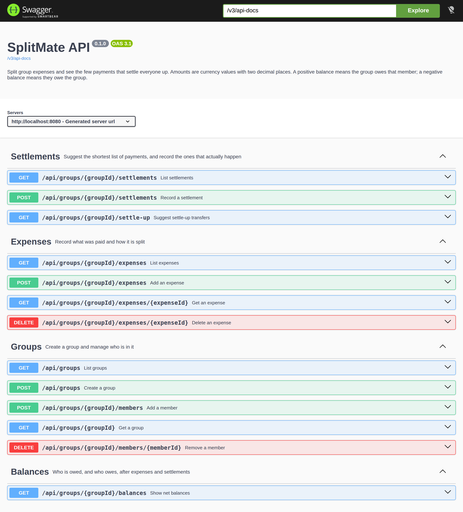

# SplitMate

SplitMate is a small REST API for groups who share expenses. Someone pays for dinner, someone else pays for the tickets, and instead of a spreadsheet of pairwise debts you get each person's net balance and a short list of payments that settle the group.

## Features

- Create groups and add or remove members.
- Record an expense paid by one member. Split it equally, by exact amounts, or by percentage.
- Money is kept in cents. Shares are rounded half-even and any leftover cent is handed out in a fixed order, so the shares always add up to the total.
- See each member's net balance. Positive means the group owes them, negative means they owe the group.
- Ask for settle-up suggestions. The API matches the largest creditor with the largest debtor until the group is clear.
- Record a real payment between two members. That payment moves both balances.

## Tech stack

- Java 21
- Spring Boot 3.5 (Web, Data JPA, Validation)
- H2 for the default profile, PostgreSQL for the `prod` profile
- springdoc-openapi, Swagger UI at [http://localhost:8080/swagger-ui.html](http://localhost:8080/swagger-ui.html)
- JUnit 5
- Docker Compose for the API and Postgres

## Running locally

You need Java 21 and Maven.

```bash
mvn spring-boot:run
```

That uses the default profile: an in-memory H2 database, so there is nothing to install. The schema is created on startup. Tests use the same setup:

```bash
mvn verify
```

To run against PostgreSQL, start a database and use the prod profile. Compose does both:

```bash
docker compose up --build
```

The API listens on port 8080. Postgres is published on port 5432 (`splitmate` / `splitmate`).

## Swagger

Open [http://localhost:8080/swagger-ui.html](http://localhost:8080/swagger-ui.html). The raw OpenAPI document is at `/v3/api-docs`.



## Example: a weekend in Porto

Ana, Bruno and Carla are sharing a trip. The curls below use `jq` to pick ids out of the responses.

```bash
GROUP=$(curl -s -X POST localhost:8080/api/groups \
  -H 'Content-Type: application/json' \
  -d '{"name":"Weekend in Porto"}' | jq -r .id)

ANA=$(curl -s -X POST localhost:8080/api/groups/$GROUP/members \
  -H 'Content-Type: application/json' \
  -d '{"name":"Ana"}' | jq -r .id)

BRUNO=$(curl -s -X POST localhost:8080/api/groups/$GROUP/members \
  -H 'Content-Type: application/json' \
  -d '{"name":"Bruno"}' | jq -r .id)

CARLA=$(curl -s -X POST localhost:8080/api/groups/$GROUP/members \
  -H 'Content-Type: application/json' \
  -d '{"name":"Carla"}' | jq -r .id)
```

Ana pays 90.00 for dinner, split three ways. Each share is 30.00, so Ana is owed 60.00 and the other two owe 30.00 each.

```bash
curl -s -X POST localhost:8080/api/groups/$GROUP/expenses \
  -H 'Content-Type: application/json' \
  -d '{
    "description": "Dinner",
    "amount": 90.00,
    "paidBy": "'"$ANA"'",
    "splitType": "EQUAL",
    "shares": [
      {"memberId": "'"$ANA"'"},
      {"memberId": "'"$BRUNO"'"},
      {"memberId": "'"$CARLA"'"}
    ]
  }'
```

Bruno then pays 40.00 for tickets. Ana and Carla take half each, so Bruno is not in the split. He is credited the full 40.00, and Ana and Carla are debited 20.00.

```bash
curl -s -X POST localhost:8080/api/groups/$GROUP/expenses \
  -H 'Content-Type: application/json' \
  -d '{
    "description": "Tickets",
    "amount": 40.00,
    "paidBy": "'"$BRUNO"'",
    "splitType": "PERCENTAGE",
    "shares": [
      {"memberId": "'"$ANA"'", "value": 50.00},
      {"memberId": "'"$CARLA"'", "value": 50.00}
    ]
  }'
```

Balances are now Ana +40.00, Bruno +10.00, Carla -50.00:

```bash
curl -s localhost:8080/api/groups/$GROUP/balances | jq
```

Settle-up does not replay the two expenses. It only looks at those nets and suggests two payments:

```bash
curl -s localhost:8080/api/groups/$GROUP/settle-up | jq
```

```text
Carla pays Ana 40.00
Carla pays Bruno 10.00
```

Record them and every balance goes to zero. Further suggestions come back as an empty list.

```bash
curl -s -X POST localhost:8080/api/groups/$GROUP/settlements \
  -H 'Content-Type: application/json' \
  -d '{"fromMemberId":"'"$CARLA"'","toMemberId":"'"$ANA"'","amount":40.00,"note":"Dinner and tickets"}'

curl -s -X POST localhost:8080/api/groups/$GROUP/settlements \
  -H 'Content-Type: application/json' \
  -d '{"fromMemberId":"'"$CARLA"'","toMemberId":"'"$BRUNO"'","amount":10.00,"note":"Dinner and tickets"}'

curl -s localhost:8080/api/groups/$GROUP/balances | jq
curl -s localhost:8080/api/groups/$GROUP/settle-up | jq
```

An exact split that does not add up is rejected. The error body is the same shape for every failure: `timestamp`, `status`, `error`, `message`, `path`, and `fieldErrors`.

```bash
curl -s -X POST localhost:8080/api/groups/$GROUP/expenses \
  -H 'Content-Type: application/json' \
  -d '{
    "description": "Groceries",
    "amount": 90.00,
    "paidBy": "'"$ANA"'",
    "splitType": "EXACT",
    "shares": [
      {"memberId": "'"$ANA"'", "value": 30.00},
      {"memberId": "'"$BRUNO"'", "value": 50.00}
    ]
  }'
```

```json
{
  "status": 400,
  "error": "Bad Request",
  "message": "Exact amounts sum to 80.00 but the expense is 90.00",
  "path": "/api/groups/…/expenses",
  "fieldErrors": []
}
```

`EQUAL` ignores `value`. `EXACT` reads `value` as money and requires the amounts to sum to the total. `PERCENTAGE` reads `value` as a percent and requires the percentages to sum to 100. A total such as 100.00 split three ways becomes 33.34, 33.33 and 33.33. The extra cent goes to the lowest member id.

## Project structure

```text
src/main/java/com/splitmate
├── common          audited base entity, money rounding, error body
├── group           groups and members
├── expense         expenses, plus equal / exact / percentage strategies
├── balance         net balance per member
└── settlement      settle-up suggestions and recorded payments
```

Controllers take records, services do the work, and JPA entities stay inside the feature that owns them.

## What I learned

**BigDecimal for money.** I stopped thinking of amounts as doubles. Everything is scaled to two decimal places with half-even rounding, then converted to cents when a split has to absorb a remainder. Half-even on its own can leave the shares a cent short or a cent over, so the allocator walks the list and moves one cent at a time until the parts sum to the total. The walk is in member-id order, which means the same people always get the same extra cent.

**A strategy per split.** Equal, exact and percentage splits disagree about what `value` means and about which totals are legal. Putting that in one `switch` would have mixed validation with the expense workflow. Each strategy implements the same `split` method, and the expense service only checks that the members belong to the group.

**Greedy settle-up.** Once every expense and payment has been folded into a net balance, the individual bills do not matter. Matching the biggest creditor with the biggest debtor, and repeating, clears the group in a handful of transfers. When two people owe the same amount, the lower member id goes first, so the suggestion does not change between calls.

**One error shape.** Bean validation, a percentage that sums to 99.99, a missing group and a bad UUID all go through `@RestControllerAdvice`. Clients can read `message` and `fieldErrors` without special cases per endpoint.

**OpenAPI next to the code.** Descriptions and examples live on the controller methods and the records, and springdoc turns that into Swagger UI. Writing the example for an exact split forced me to spell out that the amounts have to sum to the total, which is the rule people actually get wrong.

**Profiles.** The default profile is H2 so `mvn spring-boot:run` and the tests need no database. `prod` points at Postgres and is what the Docker image starts with. The Java is the same either way.
